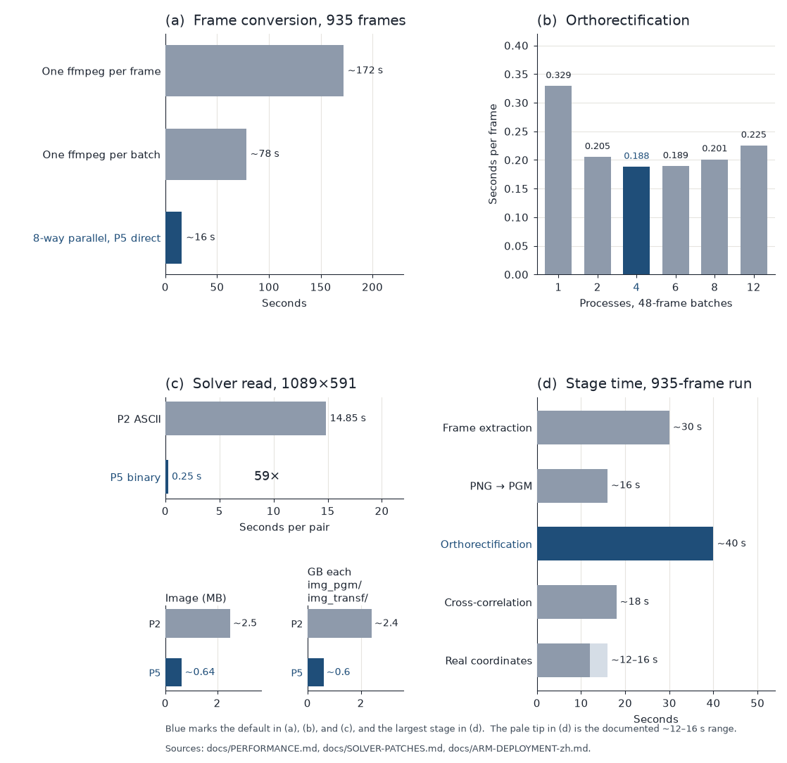

# LSPIV_Edge

**Turn a river video into a surface-velocity table — one command, no clicking through a GUI.**

`LSPIV_Edge` is a batch driver for [Fudaa-LSPIV](https://riverhydraulics.riverly.inrae.fr/eng/tools/measurement-software/fudaa-lspiv), large-scale particle image velocimetry software co-developed by EDF and INRAE with DeltaCAD. Instead of stepping through the graphical interface for every frame set, you hand it a video and it runs the whole chain automatically:

```
video  →  frame extraction  →  orthorectification  →  cross-correlation  →  CSV
```

It was built for hydrology field work: **fast**, **scriptable**, and able to run on a small ARM board (Raspberry Pi / Orange Pi class) next to the river, with no GUI.

---

## Quick start

### Windows

```bat
git clone https://github.com/WaterShadow-SHZU/LSPIV_Edge-release.git
cd LSPIV_Edge-release
```

1. Install FFmpeg and make both `ffmpeg` and `ffprobe` available on `PATH`.
2. Copy the calibration files from your Fudaa-LSPIV project's `outputs.dir` into `calib\` — see [`calib/README.txt`](calib/README.txt) for the list.
3. **Drag your video onto `process_video.bat`.**
4. When it finishes: **double-click `export_csv.bat`** → open `runs\<your-run>\export\vel_real.csv` in Excel.

The six solver binaries (`bin/windows/*.exe`) are included — no compiler is needed to run on Windows. FFmpeg is not bundled; see [Building](docs/BUILDING.md) for build instructions.

### Linux / ARM board

```bash
# 1) toolchain (once)
sudo apt update && sudo apt install -y gfortran make python3 ffmpeg

# 2) build the solver for this machine (~1-3 min)
bash tools/arm/build_arm.sh
#    -> prints 4 [OK] lines verifying the patches are present, then builds into
#       tools/arm/exes_arm/

# 3) run
bash process_video.sh your_video.mp4
```

`process_video.sh` picks up `tools/arm/exes_arm/` automatically.

> **Note** — `.bat` files are Windows-only and cannot run on the board. On Linux/ARM always use the `.sh` equivalents (`process_video.sh`, `export_csv.sh`). `process_video.sh` may be launched from any directory: it resolves the video path first and then runs inside the repository, so results always land in the repository's own `runs/`.

---

## Performance

The figure uses the measurements recorded for a 935-frame, 1920×1080 run on a 12-core desktop. Treat the proportions as transferable and the absolute times as machine-specific. After these optimisations, orthorectification is the largest remaining cost. Tables and the method are in the [performance notes](docs/PERFORMANCE.md).



*(a)* PNG to PGM for 935 frames: one ffmpeg per frame ~172 s, one ffmpeg per batch ~78 s, eight ffmpeg processes writing P5 directly ~16 s. *(b)* Orthorectification on 48-frame batches: 0.329, 0.205, 0.188, 0.189, 0.201, and 0.225 s/frame at 1, 2, 4, 6, 8, and 12 processes. The minimum is at 4, the default; 8 and 12 are slower. *(c)* A 1089×591 image is ~2.5 MB as P2 and ~0.64 MB as P5. The solver reads a pair in 14.85 s from P2 and in 0.25 s from P5, 59× ([solver patches](docs/SOLVER-PATCHES.md)). On this run, `img_pgm/` and `img_transf/` each drop from about 2.4 GB to about 0.6 GB ([ARM deployment](docs/ARM-DEPLOYMENT-zh.md)). *(d)* Stage times from the same performance note. Orthorectification is ~40 s and is listed at ~46%, the largest share. Parsing in the transform fell from 0.335 s/frame to 0.070 s/frame (4.8×, byte-identical), and the reproducibility fix leaves 0 difference across all 9 columns.

Redraw the figure with `python3 docs/images/plot_performance.py`.

---

## ARM 部署（香橙派 / 树莓派）

### 在板子上：编译 + 自检

```bash
# 1) 装工具链
sudo apt update
sudo apt install -y gfortran make python3 ffmpeg

# 2) 进目录
cd ~/LSPIV_Edge-release

# 3) 编译解算器（约 1–3 分钟）
bash tools/arm/build_arm.sh
#    先打印补丁校验：看到 4 行 [OK] 才算通过
#    → 产出 tools/arm/exes_arm/PIV.x transf_a.x vel_transf.x filter.x vel_scal.x ortho_plan.x

# 4) 环境自检
python3 -c 'import sys;print("python3 =", "%d.%d.%d"%sys.version_info[:3])'
command -v ffmpeg ffprobe || echo "[X] 缺 ffmpeg/ffprobe"
for n in PIV transf_a vel_transf filter vel_scal ortho_plan; do
    [ -f "./tools/arm/exes_arm/$n.x" ] && echo "  [OK] $n.x" || echo "  [X] 缺 $n.x"
done
[ -f ./config.json ] || cp ./config.example.json ./config.json
```

### 跑起来

```bash
# 先跑 2 对，确认能出结果（必做）
python3 lspiv_batch.py piv \
    --exes ./tools/arm/exes_arm \
    --calib ./calib \
    --img-transf ./runs/<某次运行>/img_transf \
    --pairs 1:2

# 量一次并发，定 --workers
python3 lspiv_batch.py bench \
    --calib ./calib \
    --img-transf ./runs/<某次运行>/img_transf \
    --pairs 1:24 --sweep 1,2,4,6,8

# 跑完整流水线
bash process_video.sh your_video.mp4
```

### 环境变量速查

| 变量 | 默认 | 作用 |
|---|---|---|
| `EXES` | 自动探测 `tools/arm/exes_arm` | 解算器目录 |
| `OUT` | 自动命名 | 结果目录 |
| `WORKERS` | 由 `config.json` 决定 | 并发进程数 |
| `PGMBIN` | `1`（P5） | `0` = 退回 P2 文本（慢约 59 倍） |

### 外业跑完后的清理

```bash
cd ~/LSPIV_Edge-release/runs/<本次运行>
python3 ../../export_results.py .       # 先确保 CSV 已导出
rm -rf frames/ img_pgm/ img_transf/      # 结果在 vel_raw/ vel_real/ export/
```

### 性能预期

- Cortex-A76 单核大约是桌面大核的 1/3–1/2
- Orange Pi 4 Pro 的合理预期：2 个大核大致提供 0.6–1.0 个桌面核的算力
- **磁盘**是外业部署真正的瓶颈：935 帧一次运行产出十几 GB，**强烈建议接 M.2 NVMe SSD**

---

## Repository layout

```
LSPIV_Edge-release/
├── process_video.bat / .sh     ← main entry point (video in, results out)
├── export_csv.bat / .sh        ← export results to CSV
├── lspiv_batch.py              ← the batch driver itself (all logic lives here)
├── export_results.py           ← DAT → CSV conversion (legacy + multi-frame)
├── preview_results.py          ← optional quiver plot (needs matplotlib)
├── config.example.json         ← copy to config.json to change defaults
│
├── calib/                      ← YOUR calibration files go here
├── runs/                       ← all results land here (git-ignored)
│
├── bin/windows/                ← prebuilt solver binaries for Windows (x86-64)
├── tools/
│   ├── arm/                    ← ARM build script + makefile
│   ├── solver-patches/         ← patched Fortran sources (the real source of truth)
│   │   └── upstream-original/  ← the 4 unmodified upstream files, for diffing
│   └── build_windows.bat       ← rebuild the Windows binaries
│
├── docs/
│   ├── GUIDE-zh.md             ← 中文使用说明
│   ├── SOLVER-PATCHES.md       ← what we changed in the Fortran solver, and why
│   ├── BUILDING.md             ← how to build on Windows and on ARM
│   ├── PERFORMANCE.md          ← multicore analysis, benchmark methodology
│   ├── images/                 ← comparison figure and the script that draws it
│   └── ARM-DEPLOYMENT-zh.md    ← ARM 部署说明
└── examples/                   ← how to add an example (none included)
```

---

## Documentation

| Document | What's in it |
|---|---|
| [中文使用说明](docs/GUIDE-zh.md) | 中文使用说明。 |
| [Solver patches](docs/SOLVER-PATCHES.md) | Exactly what we changed in the Fortran solver: the P5 reader, the reproducibility fix, the `Bi` crash fix. |
| [Building](docs/BUILDING.md) | Rebuilding the solver on Windows (MSYS2) and on ARM boards. |
| [Performance](docs/PERFORMANCE.md) | Why `--workers 4` is the sweet spot, how the 8-way frame conversion works, benchmark numbers. |
| [ARM deployment](docs/ARM-DEPLOYMENT-zh.md) | 香橙派 / 树莓派部署细节、外业注意事项。 |

---

## Requirements

**Runtime only** — no Python packages needed. `lspiv_batch.py` uses the standard library exclusively.

| | |
|---|---|
| Python | 3.8 or newer |
| ffmpeg | `ffmpeg` and `ffprobe` on `PATH` on Windows and Linux |
| Solver | Included for Windows; built from source on ARM |
| Optional | `matplotlib` — only for `preview_results.py` |

> The Fudaa-LSPIV **GUI is not required** to run this tool. You do need it *once*, to set up the calibration (orthorectification range, grid, PIV parameters) for a new site. After that, the calibration files are all this needs.

The repository does not include calibration data. Calibration files describe a
measurement site; only share them if they have been cleared for public release.

---

## Examples

No measurement data is currently included. See [`examples/README.md`](examples/README.md) for the format of a reproducible example.

---

## Acknowledgements

Fudaa-LSPIV is co-developed and distributed by EDF and INRAE with DeltaCAD, since 2010. LSPIV_Edge thanks those authors for the free software this driver runs.

LSPIV_Edge is an independent derivative for canal and river measurement. It is not an official product of INRAE, EDF, or DeltaCAD, and it is not endorsed by them. The names Fudaa and LSPIV belong to their respective owners.

| | |
|---|---|
| Project page | https://riverhydraulics.riverly.inrae.fr/eng/tools/measurement-software/fudaa-lspiv |
| User manual | https://gitlab.com/fudaa/fudaa-lspiv/-/wikis/home |
| GUI source (GNU GPL v2) | https://gitlab.com/fudaa/fudaa-lspiv |
| Solver source (GNU LGPL v3) | https://gitlab.irstea.fr/image_velocimetry/velocimetry_solver |

The project page is the durable entry point. The solver host `gitlab.irstea.fr` is scheduled to close on 30 June 2026.

Please cite the software as the upstream project requests:

> Le Coz, J., Jodeau, M., Hauet, A., Marchand, B., Le Boursicaud, R. (2014). Image-based velocity and discharge measurements in field and laboratory river engineering studies using the free FUDAA-LSPIV software. River Flow 2014, Lausanne, Switzerland.

The 2016 practical guide remains appropriate as well. Both citations are in [NOTICE](NOTICE).

LSPIV_Edge 感谢 EDF、INRAE 与 DeltaCAD 自 2010 年起共同开发并分发 Fudaa-LSPIV。本工具是用于渠道与河流测流的独立衍生程序，并非上述机构的官方产品，也未获得其认可。Fudaa 与 LSPIV 的名称归各自权利人所有。

---

## License

| Component | License |
|---|---|
| Original work: Python batch driver, shell and batch scripts, original build scripts (`tools/arm/build_arm.sh`, `tools/build_windows.bat`), tests, and documentation | **GPL-3.0-or-later** — GNU General Public License v3 or any later version; see [LICENSE](LICENSE) |
| `tools/solver-patches/` — the Fortran solver, except `kdtree2.f90`, and `tools/arm/makefile` | **LGPL-3.0**, inherited from INRAE `Image_Velocimetry_Solver`. `tools/arm/makefile` keeps the upstream header (LGPL-3.0, or GPL-2.0 or any later version) |
| `tools/solver-patches/kdtree2.f90` | **AFL-1.1** — Academic Free License 1.1, Matthew Kennel (2004). Text: [LICENSE.kdtree2-AFL-1.1](tools/solver-patches/LICENSE.kdtree2-AFL-1.1) |
| `bin/windows/*.exe` — prebuilt Windows solver binaries | **LGPL-3.0**, built from the solver sources above. `filter.exe` also includes `kdtree2.f90` (AFL-1.1) |
| FFmpeg and ffprobe | **Not bundled.** Install them separately and follow that build's license |
| Fudaa-LSPIV GUI | **Not included.** It remains separate software under **GPL-2.0** |

Upstream homes and the requested citation are in [Acknowledgements](#acknowledgements). Full notices are in [NOTICE](NOTICE).
